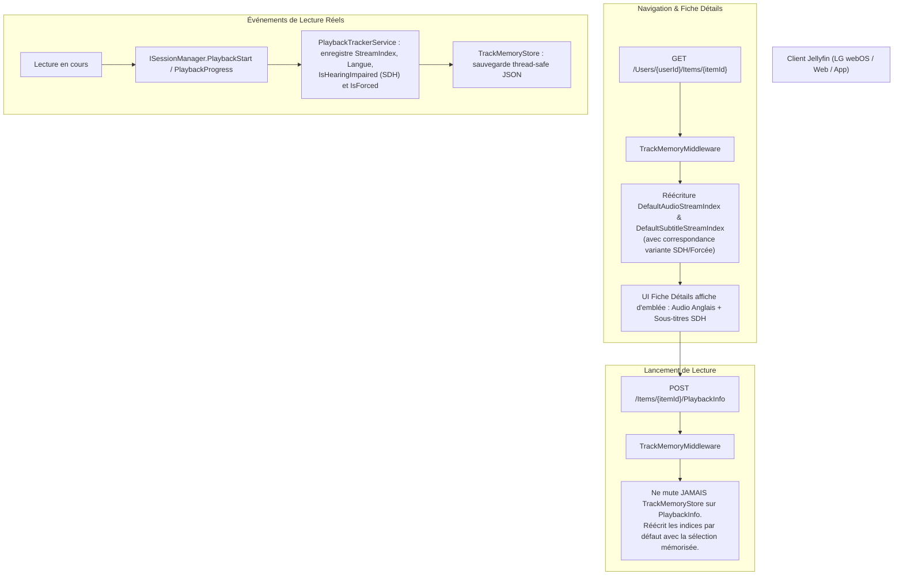

# Plan d'Implémentation : Pré-sélection sur Fiche Détails & Support des Variantes SDH/Forcées

> **Pour agents / exécutants :** RÈGLE OBLIGATOIRE : Suivre les règles globales et locales du projet (`AGENTS.md`). Les étapes utilisent la syntaxe de case à cocher (`- [ ]`). Chaque tâche doit être testée (TDD : test échouant d'abord) avant implémentation et vérifiée via `docker run --rm -v $(pwd):/src -w /src mcr.microsoft.com/dotnet/sdk:8.0 dotnet test`.

**Date :** 2026-10-25  
**Dépôt :** `Soviann/jellyfin-plugin-track-memory`  
**Branche cible :** `feat/item-details-and-sdh-track-memory`  

---

## 🎯 Problème & Diagnostic

1. **Amnésie de la page détails (`GET /Users/{userId}/Items/{itemId}`)** :
   - Le middleware [`TrackMemoryMiddleware.cs`](src/Jellyfin.Plugin.TrackMemory/Api/TrackMemoryMiddleware.cs) n'intercepte que `/PlaybackInfo`.
   - Lors de l'affichage d'un épisode (fiche détails sur TV LG webOS, web, mobile), le client appelle `GET /Users/{userId}/Items/{itemId}`. Jellyfin renvoie ses valeurs par défaut (Français selon les préférences globales du compte).
   - Les listes déroulantes Audio et Sous-titres s'affichent donc pré-sélectionnées sur Français.
2. **Piège du faux override explicite** :
   - Au clic sur « Lecture » depuis cette page détails, le client webOS transmet la valeur actuelle de ces listes déroulantes (Français) dans le corps JSON de `POST /Items/{itemId}/PlaybackInfo`.
   - Le middleware considère cette présence comme un « choix volontaire immédiat » de l'utilisateur, écrase la mémoire (`TrackMemoryStore`) avec le Français et bloque la réécriture de la réponse.
   - La mutation de `TrackMemoryStore` ne doit **jamais** se faire lors d'un simple appel `PlaybackInfo` (qui est un appel d'évaluation de transcodage), mais uniquement sur les événements réels de lecture (`PlaybackTrackerService`).
3. **Perte des variantes de sous-titres (SDH vs Complets vs Forcés)** :
   - `TrackSelection` ne retient que le code langue ISO (`eng`).
   - `FindStreamIndexByLanguage` sélectionne le tout premier flux de cette langue. Dans une vidéo ayant plusieurs pistes de la même langue (ex: Stream 5 = Anglais Forcé, Stream 6 = Anglais Complet, Stream 7 = Anglais SDH), le plugin sélectionne le flux forcé ou complet au lieu du SDH voulu.

---

## 🏗️ Architecture & Spécifications

### Éléments Techniques
1. **Domaine (`TrackSelection.cs`)** :
   - Ajout des propriétés `bool? SubtitleIsHearingImpaired` et `bool? SubtitleIsForced`.
2. **Résolution des flux (`FindStreamIndexByLanguage`)** :
   - Prioriser la correspondance exacte de variante :
     - Si `SubtitleIsHearingImpaired == true`, cibler un sous-titre de même langue ayant `IsHearingImpaired == true` (ou titre contenant "SDH").
     - Si `SubtitleIsForced == true`, cibler un sous-titre de même langue ayant `IsForced == true`.
     - Si standard (`false`), cibler un sous-titre non-SDH et non-forcé.
     - Fallback : premier flux de la langue si aucune variante exacte n'est trouvée.
3. **Interception Élargie (`TrackMemoryMiddleware.cs`)** :
   - Détecter les requêtes `GET /Users/{userId}/Items/{itemId}` et `GET /Items/{itemId}`.
   - Extraire `userId` directement depuis l'URL `/Users/{userId}/Items/{itemId}` si présent, ou via query/claims.
   - Réécrire `MediaSources` dans la réponse de la fiche détails.
4. **Suppression de la mutation intempestive dans `PlaybackInfo`** :
   - Retirer l'appel `_store.SaveSelection` dans `TrackMemoryMiddleware.InvokeAsync`. L'enregistrement des pistes appartient exclusivement à `PlaybackTrackerService` lors de la lecture effective.

---

## 📋 Chunks d'Implémentation Verifiables

### Chunk 1 : Extension du Modèle de Données & Support SDH / Forcé
- [x] Créer la branche `feat/item-details-and-sdh-track-memory` dans `jellyfin-plugin-track-memory`.
- [x] Écrire les tests unitaires pour `TrackSelection` et `TrackMemoryStoreTests` vérifiant la persistance et le rechargement de `SubtitleIsHearingImpaired` et `SubtitleIsForced`.
- [x] Mettre à jour `Domain/TrackSelection.cs`, `Services/ITrackMemoryStore.cs` et `Services/TrackMemoryStore.cs`.
- [x] Mettre à jour `Services/PlaybackTrackerService.cs` pour extraire `IsHearingImpaired` et `IsForced` depuis le flux sous-titre actif.

### Chunk 2 : Algorithme de Correspondance de Variantes de Sous-Titres
- [x] Écrire les tests unitaires dans `TrackMemoryMiddlewareTests` avec un mock JSON contenant 3 flux anglais (Forcé, Complet, SDH) :
  - Test sélection SDH $\rightarrow$ résout l'index SDH.
  - Test sélection Complet $\rightarrow$ résout l'index Complet.
  - Test sélection Forcé $\rightarrow$ résout l'index Forcé.
- [x] Implémenter la logique affinée dans `FindStreamIndexByLanguage`.

### Chunk 3 : Interception de `GET /Users/{userId}/Items/{itemId}` & Suppression de l'Écriture dans `PlaybackInfo`
- [x] Écrire les tests unitaires simulant une requête `GET /Users/{userId}/Items/{itemId}` et vérifiant la réécriture de `DefaultAudioStreamIndex` et `DefaultSubtitleStreamIndex`.
- [x] Écrire le test unitaire prouvant qu'un appel `POST /Items/{itemId}/PlaybackInfo` avec un body JSON n'écrase pas le `TrackMemoryStore`.
- [x] Adapter `TrackMemoryMiddleware.cs` :
  - Ajouter la détection des routes d'item details (`/Users/{userId}/Items/{itemId}` et `/Items/{itemId}`).
  - Supprimer la sauvegarde prématurée dans le store sur `PlaybackInfo`.
  - Harmoniser la méthode de réécriture de réponse JSON pour gérer à la fois `PlaybackInfoResponse` et `BaseItemDto`.

### Chunk 4 : Validation, Build, Packaging & Déploiement Test sur le NAS
- [x] Exécuter la suite de tests complète via Docker (`dotnet test`) $\rightarrow$ 100% vert.
- [x] Valider le manifest (`scripts/validate-manifest.py`).
- [x] Compiler en Release (`dotnet publish -c Release`).
- [x] Déployer la DLL compilée dans `/volume1/docker/jellyfin/config/plugins/Track Memory_1.2.0.0/` sur le NAS et redémarrer Jellyfin via `cd /volume1/docker/jellyfin && docker compose -p jellyfish restart`.
- [x] Vérifier dans les logs de Jellyfin et tester sur l'épisode 5 de "Below".
